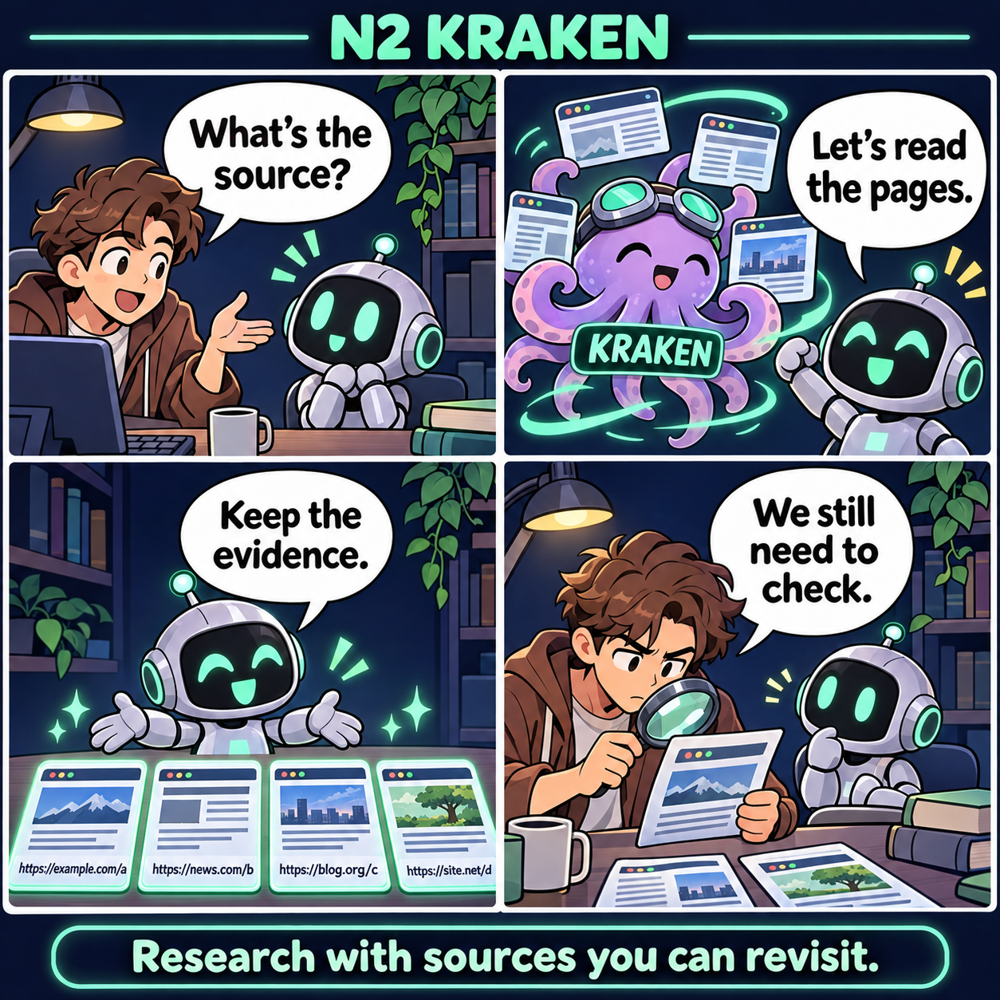
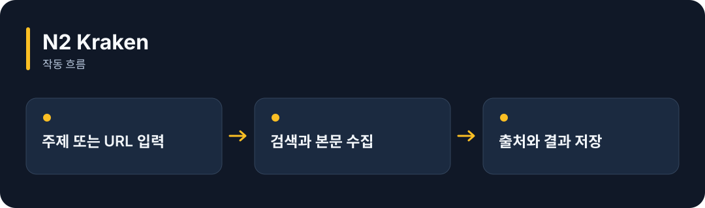

# N2 Kraken

**공개 웹에서 자료를 찾아 읽고, 조사 내용과 출처를 함께 보관합니다.**

[](https://github.com/choihyunsus/n2-kraken/releases/tag/v1.0.0) [](https://github.com/choihyunsus/n2-kraken/blob/main/docs/reference.ko.md) [](https://github.com/choihyunsus/n2-kraken/blob/main/LICENSE)

[English](README.md)

<p align="center">
  
</p>

자료의 출처를 질문하고 → 공개 웹페이지를 읽어 → 출처와 조사 결과를 보관하고 → 근거를 직접 검토합니다.

기능을 이야기로 표현한 만화입니다. 실제 앱 화면은 아닙니다.

<details>
<summary>동작 흐름 펼쳐 보기</summary>



</details>

## 이런 때 사용하세요

AI가 답하기 전에 관련 문서를 조사하거나, 나중에 출처를 다시 확인해야 하는 작업에 활용하세요.

사이트 차단, CAPTCHA, 검색 서비스 변경으로 수집이 실패할 수 있습니다. 여러 출처의 표현이 일치해도 최종 사실 판단은 사용자가 검토해야 합니다.

## 처음 실행하기

터미널에서 `node --version`을 실행해 Node.js 22 이상인지 확인하세요. 아래 명령은 새 연습 폴더를 만들고 GitHub 배포 파일을 설치합니다. 예제 파일과 DB도 이 폴더에 두면 경로를 따라가기 쉽습니다.

```sh
mkdir n2-kraken-demo
cd n2-kraken-demo
npm init -y
npm install https://github.com/choihyunsus/n2-kraken/releases/download/v1.0.0/n2-kraken-1.0.0.tgz
```

설치 중 SQLite 빌드 오류가 나오면 운영체제에 맞는 C/C++ 빌드 도구가 필요할 수 있습니다. 자세한 환경 조건은 [설치 참고](https://github.com/choihyunsus/n2-kraken/blob/main/docs/reference.ko.md)에 있습니다.

배포 워커는 Windows x64·Linux x64·macOS arm64를 지원합니다. Linux에는 glibc 2.39 이상이 필요합니다. 다른 환경의 빌드 방법은 상세 안내를 확인하세요.

아래 내용을 `demo.mjs`로 저장하세요. 파일은 방금 설치 명령을 실행한 폴더에 둡니다.

```js
import { Kraken } from 'n2-kraken';
const researcher = new Kraken({
  dbPath: './demo.db', project: 'demo', agent: 'assistant',
});
try {
  const page = await researcher.fetch({ url: 'https://example.com/' });
  console.log(page.source_url);
  console.log(page.markdown);
} finally {
  await researcher.close();
}
```

```sh
node demo.mjs
```

최종 URL과 해당 페이지의 본문이 출력됩니다. 이후 `research()`로 여러 자료를 조사하고 `learn()`으로 저장할 수 있어요.

## Soul과 함께 쓰기

여러 N2 모듈을 연결할 때 같은 `mimir.db` 파일을 지정하세요. `project`는 작업 이름, `agent`는 계속 사용할 AI 이름입니다. 같은 작업의 기록을 이어 쓰려면 이 값들을 맞춥니다. 단독 사용도 같은 필드 구조를 사용합니다.

## 다음 단계와 상세 안내

[전체 사용 안내](https://github.com/choihyunsus/n2-kraken/blob/main/docs/reference.ko.md)에서 실제 앱 연결, API, 지원 범위, 복구 절차와 검증 범위를 확인할 수 있습니다. [배포 파일](https://github.com/choihyunsus/n2-kraken/releases/tag/v1.0.0)에는 설치할 버전과 변경 설명이 있습니다.

처음 나오는 용어는 이렇게 읽으면 됩니다. **MCP**는 AI 앱의 도구 연결 방식, **DB**는 저장 파일, **호스트**는 이 모듈을 연결해 실행하는 앱입니다.

사용·재배포 조건은 [라이선스](https://github.com/choihyunsus/n2-kraken/blob/main/LICENSE)를 확인하세요. 의존 모듈에는 별도 조건이 적용될 수 있으며, 상업 이용 조건은 상세 안내에 함께 설명되어 있습니다.
