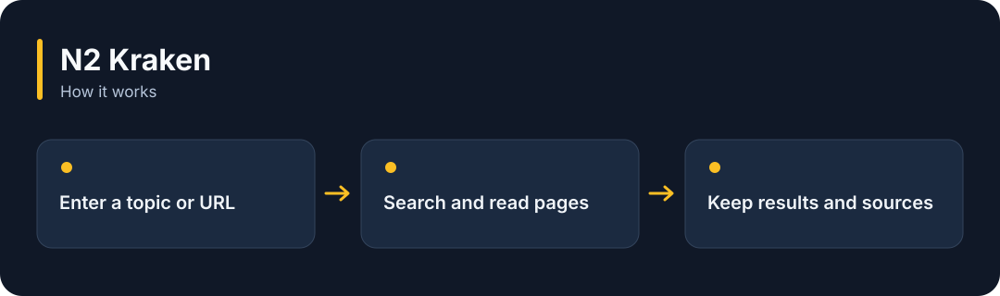

# N2 Kraken

**Find and read public web material, keeping the research together with its sources.**

[](https://github.com/choihyunsus/n2-kraken/releases/tag/v1.0.0) [](https://github.com/choihyunsus/n2-kraken/blob/main/docs/reference.md) [](https://github.com/choihyunsus/n2-kraken/blob/main/LICENSE)

[한국어](README.ko.md)



## When to use it

Research documents before an AI answers, or keep sources available for a later review.

Sites may block requests, require a CAPTCHA or change their search format. Agreement between sources still needs a review of the underlying facts.

## Try it

Run `node --version` in a terminal and check for Node.js 22 or later. These commands create a fresh practice folder and install the GitHub release. Keep the example file and database in this folder.

```sh
mkdir n2-kraken-demo
cd n2-kraken-demo
npm init -y
npm install https://github.com/choihyunsus/n2-kraken/releases/download/v1.0.0/n2-kraken-1.0.0.tgz
```

If installation reports a SQLite build error, you may need your platform’s C/C++ build tools. See the [installation reference](https://github.com/choihyunsus/n2-kraken/blob/main/docs/reference.md) for platform requirements.

Bundled workers support Windows x64, Linux x64 and macOS arm64. Linux requires glibc 2.39 or later. See the reference for building on other environments.

Save the following as `demo.mjs` in the folder where you ran the install command.

```js
import { Kraken } from 'n2-kraken';
const researcher = new Kraken({
  dbPath: './demo.db', project: 'demo', agent: 'assistant',
});
try {
  const page = await researcher.fetch({ url: 'https://example.com/' });
  console.log(page.source_url);
  console.log(page.markdown);
} finally {
  await researcher.close();
}
```

```sh
node demo.mjs
```

The final URL and the page body appear. Continue with `research()` for multiple sources and `learn()` to save the findings.

## Using it with Soul

Point connected N2 modules at the same `mimir.db` file. `project` names the work and `agent` names the AI identity you will keep using. Match those values to continue working with the same records. Standalone use follows the same field layout.

## Next steps and reference

The [full reference](https://github.com/choihyunsus/n2-kraken/blob/main/docs/reference.md) covers app integration, APIs, supported features, recovery and validation. The [release page](https://github.com/choihyunsus/n2-kraken/releases/tag/v1.0.0) contains the installable version and release notes.

A few terms used in the reference: **MCP** connects tools to an AI app, a **database** stores records, and the **host** is the app that connects and runs this module.

Review the [license](https://github.com/choihyunsus/n2-kraken/blob/main/LICENSE) for use and redistribution. Dependencies can have their own terms, including commercial-use conditions described in the reference.
